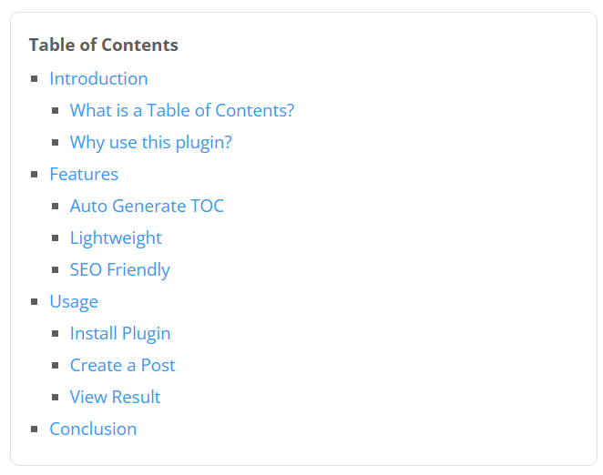

# ABO YUMA Wordpress Table of Contents

A lightweight custom WordPress plugin that automatically generates a Table of Contents from H2 and H3 headings. Built specifically for the ABO YUMA theme. The purpose of this plugin is to improve readability for users and support SEO.

The H1 tag is typically reserved for the page or post title in WordPress.  
This plugin focuses on reflecting content structure:

- **H2** represents main sections of the content  
- **H3** represents subsections under each H2  

## ✨ Features

* Automatically generate TOC from H2 and H3 headings
* Adds anchor links to headings
* Nested structure (H2 → H3)
* Lightweight (no external libraries)
* Inline CSS (no extra files)
* Works automatically on single post pages
* No database changes required

---

## ⚙️ Installation

1. Upload the plugin folder to `/wp-content/plugins/`
2. Activate the plugin from the WordPress admin panel

## ⚠️ Notes

* Only works on `single post` pages
* Requires proper use of `<h2>` and `<h3>` in content
* IDs are automatically generated for anchor linking

## 🎨 Theme Compatibility

This plugin is designed to work best with themes that use **Bootstrap 5** variables.

It uses CSS variables such as:
- `--bs-border-color`
- `--bs-body-bg`

If your theme does not use Bootstrap, the TOC will still work, but you have to adjust the styling manually.

